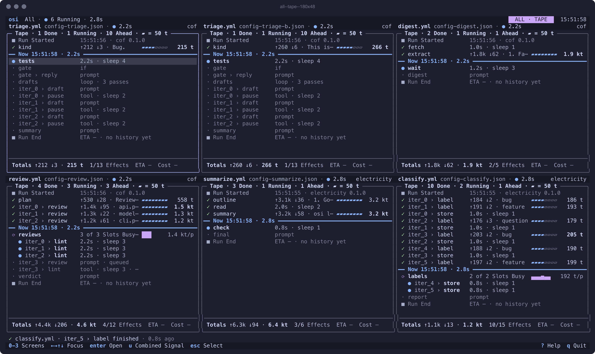
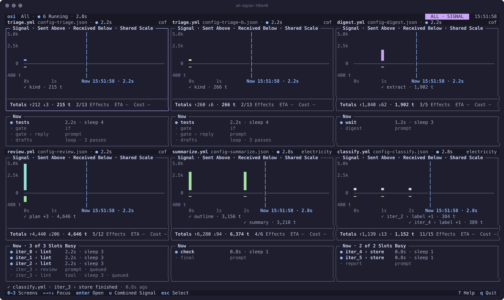
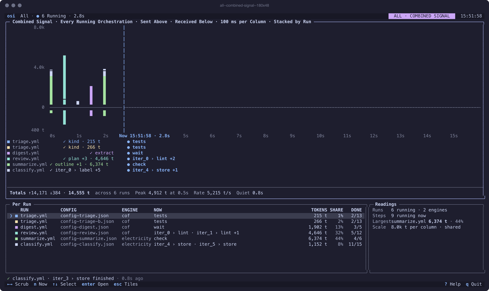

# osi — terminal UI design

*Design v1, November 2026. Every figure in this document is a frame drawn from a real run of `cof` or
`electricity`; nothing on screen is invented. Companion to `../DESIGN.md` §6.3: where the two differ, this
document is the intent and §6.3 describes what ships today. §8 lists the differences.*

Figures: `frames/<screen>--<state>--<cols>x<rows>.mock` (plain text, every state) and `.png` (the eight pages).
`gallery.html` shows the eight pages in three colour themes with keyboard navigation; `gallery-states.html`
every state and size. Regenerating them is Appendix B.

---

## 1. What osi puts on screen

`osi` launches a Circuitry orchestration, or attaches to one, and answers three questions while it runs:
**what will happen, what is happening, what happened**, with the tokens that went to and came back from the
model and the metadata around each step. Four screens look at one run; two more handle many runs.

| Key | Screen | One sentence |
| --- | --- | --- |
| `0` | **Tape** | Home. One time axis: what has happened above the Now band, what is running on it, what comes next below, with a fixed-scale token column. |
| `1` | **Signal** | The oscilloscope trace: tokens per 100 ms over the run, sent above the axis, received below, the Now sweep, the plan ahead. |
| `2` | **Flow** | The rail: the plan as stations left to right, lanes for branches and loop passes, following the running step. |
| `3` | **Store** | Where the tokens went: an area diagram by store (step), the largest stores, readings. |
| | **Select** | Shown when `osi` starts with no document and finds running orchestrations: pick one, or All. |
| | **All** | One full osi per running orchestration, tiled in a grid; the screen keys switch every tile at once; `u` folds them into one Combined Signal. |

### 1.1 Principles the frames follow

- **Terminal-honest.** Unicode glyphs and box drawing only, truecolour with 256- and 16-colour fallbacks, bold and dim as the only attributes that carry meaning, `NO_COLOR` respected. Nothing depends on colour alone.
- **Nothing shown that has not happened.** Rows ahead are faint and say what they *will* do; figures that are not known read `—`. The Store draws only tokens used so far.
- **One clock.** Every time on a frame comes from the same instant: the header clock, the Now band, the status line's `0.6s ago`, the ETA.
- **Fixed scales.** The token bar is `▰ = 50 t` and never rescales during a run; the Signal axis is fixed for the run; the Combined Signal shares one scale across runs. Numbers are always printed next to a bar.
- **Chrome in Title Case, data unchanged.** Panel titles, legends and key labels are Title Case; step names, values and engine text are exactly as the engine wrote them (`gate › reply`, `cats`, `cof 0.1.0`).
- **Weight rule.** Bold for the running step names, one headline figure per region, deviations, section headings, the Now rule label and the key in a key hint. Faint for what is ahead and for metadata. Everything else regular.
- **Every advertised key works.** A key in a key bar has a designed effect, and the Help overlay lists exactly the key bars' keys.

---

## 2. The screens

### 2.1 Tape (`0`)

```text
 osi  demo.yml · ● Running 3.6s                                                                        TAPE    12:50:50
╭─ Tape · 6 Done · 2 Running · 4 Ahead · ▰ = 50 t · Previews On ───────────╮╭─ gate › reply · Selected ────────────────╮
│                                                                          ││ Status  ✓ Done  0.0s · 12:50:50          │
│12:50:50 ✓ tests              3.0s · sleep 3                              ││ Type    prompt · scripted-model          │
│12:50:50 ◆ gate → then        kind != ""                                  ││ Tokens  ↑348 ↓41 · 389 t                 │
│12:50:50 ✓ gate › reply       ↑348 ↓41 · Thanks for the ⋯ ▰▰▰▰▰▰▰▰   389 t││ Usual   265 t  +47% · median of 3 runs   │
│             › Reply as the maintainer (kind: Bug.). Iss⋯                 ││ Share   45% of this run so far           │
│12:50:50 ✓ iter_0 › draft     ↑118 ↓12 · Cats nap in sun⋯ ▰▰▰▱▱▱▱▱   130 t││                                          │
│             › Write one sentence about cats.                             ││ Prompt Sent · 348 t                      │
│12:50:50 ✓ iter_1 › draft     ↑118 ↓13 · Dogs greet the ⋯ ▰▰▰▱▱▱▱▱   131 t││ Reply as the maintainer (kind: Bug.).    │
│             › Write one sentence about dogs.                             ││ Issue: parse_duration fails on 1h30m     │
│━━ Now 12:50:50 · 3.6s ━━━━━━━━━━━━━━━━━━━━━━━━━━━━━━━━━━━━━━━━━━━━━━━━━━━││ with ValueError: invalid duration. 90m   │
│12:50:50 ⟳ drafts             2 of 2 Slots Busy · 1 Pass⋯ ▃▃       130 t/p││ works.                                   │
│12:50:50   ● iter_0 › pause   0.6s · sleep 1                              ││                                          │
│12:50:50   ● iter_1 › pause   0.6s · sleep 1                              ││ Reply · 41 t                             │
│         · iter_2 › draft     prompt · queued             usually 155 t   ││ Thanks for the report. We will look into │
│             › Write one sentence about {{topic}}.                        ││ why 1h30m fails while 90m works and fix  │
│         · iter_2 › pause     tool · sleep 1 · queued                     ││ it in the next release.                  │
│         · flaky              tool · ls /nonexistent-osi⋯                 ││                                          │
│         · summary            prompt                      usually 402 t   ││                                          │
│             › Summarize the drafts in one line.                          ││                                          │
│         ■ Run End            usually 1.3 kt · 5.1s      ETA 12:50:52     ││                                          │
│                                                                          ││                                          │
│                                                                          ││                                          │
│                                                                          ││                                          │
│──────────────────────────────────────────────────────────────────────────││                                          │
│ Totals ↑796 ↓69 · 865 t  +12% Usual  6/14 Effects  ETA 12:50:52  Cost —  ││                                          │
╰──────────────────────────────────────────────────────────────────────────╯╰──────────────────────────────────────────╯
 ✓ iter_1 › draft finished · ↑118 ↓13 · 0.6s ago
 ↑↓ Select  enter Open  p Previews  t Tokens  0-3 Screens                                                ? Help  q Quit
```
*`frames/tape--normal--120x30.mock` · [png](frames/tape--normal--120x30.png)*

**Anatomy, left to right.** The event clock (`12:50:50`), the status glyph, the step's own breadcrumb (its
parents, every one of them dim, down to its own name in the row's own colour), what the step did, and the token
column. A finished prompt reads `↑212 ↓3 · Bug.` (sent, received, the reply's first words); a finished tool
`3.0s · sleep 3`; a decision `gate → then` with its condition; a finished loop `3 passes · 2 wide · 0 done`; a
running loop `2 of 2 Slots Busy · 1 Pass Queued`.

**Top to bottom.** `■ Run Started` with the document and engine. Finished rows in the order they finished, each
prompt followed by one faint preview line (`› Is this issue a bug…`) of the text actually sent, when previews are
on (`p`). The **Now band**, `━━ Now 12:50:50 · 3.6s ━━`, a full-width rule in the accent colour. Below it, the
Now area's own tree: every running step and every running loop, each loop's own counts in its `what` column
rather than a separate rule, its running children indented two cells per level under it. Then the rows ahead, faint, with their type first (`prompt · queued`, `tool · sleep 1 · queued`) and
`usually 155 t` in the token column when history knows the step. `■ Run End` closes the list with the usual total
and duration, and the ETA in the token column. The Now area's own middle row sits on the list's own middle row:
finished rows fill upward from it, newest closest, the oldest scrolling off the top; rows ahead fill downward, the
latest scrolling off the bottom; blank above when the past is short, blank below when the plan is short.

**Token column** (16 cells). `▰▰▰▰▱▱▱▱   215 t`: eight bar cells at a fixed 50 tokens each, then the count in
t, kt, Mt (§3.5). The largest step so far has the only bold number. A loop row shows a
sparkline of its finished passes and the per-pass average, `▃▃   130 t/p`. Pressing `t` swaps the column for
each step's deviation from its usual: `────┼▓▓▓▓  +47%`, a baseline tick with up to four cells per side at
12.5 % each, coloured by the deviation (§3.6):

```text
 osi  demo.yml · ● Running 3.6s                                                                        TAPE    12:50:50
╭─ Tape · 6 Done · 2 Running · 4 Ahead · vs Usual · 3 Runs · Previews On ──╮╭─ gate › reply · Selected ────────────────╮
│                                                                          ││ Status  ✓ Done  0.0s · 12:50:50          │
│12:50:50 ✓ tests              3.0s · sleep 3                              ││ Type    prompt · scripted-model          │
│12:50:50 ◆ gate → then        kind != ""                                  ││ Tokens  ↑348 ↓41 · 389 t                 │
│12:50:50 ✓ gate › reply       ↑348 ↓41 · Thanks for the ⋯ ────┼▓▓▓▓  +47% ││ Usual   265 t  +47% · median of 3 runs   │
│             › Reply as the maintainer (kind: Bug.). Iss⋯                 ││ Share   45% of this run so far           │
│12:50:50 ✓ iter_0 › draft     ↑118 ↓12 · Cats nap in sun⋯ ───▓┼────  -16% ││                                          │
│             › Write one sentence about cats.                             ││ Prompt Sent · 348 t                      │
│12:50:50 ✓ iter_1 › draft     ↑118 ↓13 · Dogs greet the ⋯ ───▓┼────  -14% ││ Reply as the maintainer (kind: Bug.).    │
│             › Write one sentence about dogs.                             ││ Issue: parse_duration fails on 1h30m     │
│━━ Now 12:50:50 · 3.6s ━━━━━━━━━━━━━━━━━━━━━━━━━━━━━━━━━━━━━━━━━━━━━━━━━━━││ with ValueError: invalid duration. 90m   │
│12:50:50 ⟳ drafts             2 of 2 Slots Busy · 1 Pass⋯ ▃▃       130 t/p││ works.                                   │
│12:50:50   ● iter_0 › pause   0.6s · sleep 1                              ││                                          │
│12:50:50   ● iter_1 › pause   0.6s · sleep 1                              ││ Reply · 41 t                             │
│         · iter_2 › draft     prompt · queued             usually 155 t   ││ Thanks for the report. We will look into │
│             › Write one sentence about {{topic}}.                        ││ why 1h30m fails while 90m works and fix  │
│         · iter_2 › pause     tool · sleep 1 · queued                     ││ it in the next release.                  │
│         · flaky              tool · ls /nonexistent-osi⋯                 ││                                          │
│         · summary            prompt                      usually 402 t   ││                                          │
│             › Summarize the drafts in one line.                          ││                                          │
│         ■ Run End            usually 1.3 kt · 5.1s      ETA 12:50:52     ││                                          │
│                                                                          ││                                          │
│                                                                          ││                                          │
│                                                                          ││                                          │
│──────────────────────────────────────────────────────────────────────────││                                          │
│ Totals ↑796 ↓69 · 865 t  +12% Usual  6/14 Effects  ETA 12:50:52  Cost —  ││                                          │
╰──────────────────────────────────────────────────────────────────────────╯╰──────────────────────────────────────────╯
 ✓ iter_1 › draft finished · ↑118 ↓13 · 0.6s ago
 ↑↓ Select  enter Open  p Previews  t Tokens  0-3 Screens                                                ? Help  q Quit
```
*`frames/tape--usual--120x30.mock` · [png](frames/tape--usual--120x30.png)*

**Detail pane** (right, 44 columns at 120). The selected row, title `gate › reply · Selected`: Status, Type,
Tokens (`↑348 ↓41 · 389 t`), Usual (`265 t  +47% · median of 3 runs`), Share of the run so far, then the
prompt sent and the reply in full, each headed with its token count. Arrow keys move the selection; `enter`
opens the step full-screen (the same content with room for the whole prompt and reply).

**Totals row**, pinned above the bottom border and identical on every single-run screen:
`Totals ↑796 ↓69 · 865 t  +12% Usual  6/14 Effects  ETA 12:50:52  Cost —`. Cost shows a figure once an engine
reports one (`meta.cost_usd`, `runtime.last_run.totals.cost_usd`).

**Status line** under the pane: the newest finished step, `✓ gate › reply finished · ↑348 ↓41 · 0.6s ago`.

**States.**

- *Starting* (`tape--starting`): no events yet. The head rule reads `━━ Starting · cof 0.1.0 launching · no events yet ━━`; every row is ahead with its usual cost; the detail pane shows Engine, Plan (`14 effects · 6 prompts · 5 tools`), Shape, Usual, ETA if usual, and the first step.
- *Ended* (`tape--ended`): every row above the head; the head reads `━━ Run Ended · OK · 5.1s · 12:50:52 ━━`; the handled failure (`✗ flaky  exit 1 · handled · on_error: continue`) in the warning colour; the detail pane shows Outcome, Tokens, Usual, Effects (`14 of 14 · 1 handled failure`), Decision, Largest, the handled failure's error and the run's summary value.
- *Failed* (`tape--failed`): the head reads `━━ Run Failed · 0.0s · 12:48:49 ━━` in the error colour; the failing row carries the engine's message; every unreached row reads `skipped · not reached · …`; the detail pane shows the error in full and the list of what was not reached.
- *Help* (`tape--help`): a 72×18 overlay, `Help · Tape`, listing the keys of §4 and the glyph legend; `esc` or `?` closes it.
- *Usual* (`tape--usual`): the token column after `t`, above.

**Sizes.** At 80×24 the detail pane is dropped and `enter` opens the details in its place; previews are off by
default. At 60×24 (a split pane) the time and info columns go too, leaving glyph, name and the token column.
Below 60×24 the too-small screen names the minimum and points at `osi --log`:

```text
 osi  demo.yml · ● Running 3.6s                                TAPE    12:50:50
╭─ Tape · 6 Done · 2 Running · 4 Ahead · ▰ = 50 t ─────────────────────────────╮
│12:50:47 ✓ kind               ↑212 ↓3 · Bug.                  ▰▰▰▰▱▱▱▱   215 t│
│12:50:50 ✓ tests              3.0s · sleep 3                                  │
│12:50:50 ◆ gate → then        kind != ""                                      │
│12:50:50 ✓ gate › reply       ↑348 ↓41 · Thanks for the repo⋯ ▰▰▰▰▰▰▰▰   389 t│
│12:50:50 ✓ iter_0 › draft     ↑118 ↓12 · Cats nap in sunbeam⋯ ▰▰▰▱▱▱▱▱   130 t│
│12:50:50 ✓ iter_1 › draft     ↑118 ↓13 · Dogs greet the mail⋯ ▰▰▰▱▱▱▱▱   131 t│
│━━ Now 12:50:50 · 3.6s ━━━━━━━━━━━━━━━━━━━━━━━━━━━━━━━━━━━━━━━━━━━━━━━━━━━━━━━│
│12:50:50 ⟳ drafts             2 of 2 Slots Busy · 1 Pass Que⋯ ▃▃       130 t/p│
│12:50:50   ● iter_0 › pause   0.6s · sleep 1                                  │
│12:50:50   ● iter_1 › pause   0.6s · sleep 1                                  │
│         · iter_2 › draft     prompt · queued                 usually 155 t   │
│         · iter_2 › pause     tool · sleep 1 · queued                         │
│         · flaky              tool · ls /nonexistent-osi-dem⋯                 │
│         · summary            prompt                          usually 402 t   │
│         ■ Run End            usually 1.3 kt · ETA 12:50:52                   │
│                                                                              │
│                                                                              │
│──────────────────────────────────────────────────────────────────────────────│
│ Totals ↑796 ↓69 · 865 t  +12% Usual  6/14 Effects  ETA 12:50:52  Cost —      │
╰──────────────────────────────────────────────────────────────────────────────╯
 ✓ iter_1 › draft finished · ↑118 ↓13 · 0.6s ago
 ↑↓ Select  enter Open  p Previews  t Tokens  0-3 Screens        ? Help  q Quit
```
*`frames/tape--normal--80x24.mock` · [png](frames/tape--normal--80x24.png)*

```text
 osi  demo.yml · ● Running 3.6s            TAPE    12:50:50
╭─ Tape · 6/14 · ▰ = 50 t ─────────────────────────────────╮
│■ Run Started                                             │
│✓ kind                                    ▰▰▰▰▱▱▱▱   215 t│
│✓ tests                                                   │
│◆ gate → then                                             │
│✓ gate › reply                            ▰▰▰▰▰▰▰▰   389 t│
│✓ iter_0 › draft                          ▰▰▰▱▱▱▱▱   130 t│
│✓ iter_1 › draft                          ▰▰▰▱▱▱▱▱   131 t│
│━━ Now 12:50:50 · 3.6s ━━━━━━━━━━━━━━━━━━━━━━━━━━━━━━━━━━━│
│⟳ drafts                                  ▃▃       130 t/p│
│  ● iter_0 › pause                                        │
│  ● iter_1 › pause                                        │
│· iter_2 › draft                          usually 155 t   │
│· iter_2 › pause                                          │
│· flaky                                                   │
│· summary                                 usually 402 t   │
│■ Run End                                                 │
│──────────────────────────────────────────────────────────│
│ Totals 865 t +12% · 6/14 · ETA 12:50:52                  │
╰──────────────────────────────────────────────────────────╯
 ✓ gate › reply finished · 0.6s ago
 ↑↓ Select  enter Open  t Tokens             ? Help  q Quit
```
*`frames/tape--normal--60x24.mock` · [png](frames/tape--normal--60x24.png)*

### 2.2 Signal (`1`)

```text
 osi  demo.yml · ● Running 3.6s                                                                      SIGNAL    12:50:50
╭─ Signal · Tokens to scripted-model · Sent Above · Received Below · 100 ms per Column · Fixed Scale ──────────────────╮
│600 t                               ▇     ┃                                                                           │
│                                    █     ┃                                                                           │
│300 t                               █     ┃                                                                           │
│      ▆                             █     ┃                                                                           │
│      █                             █     ┃                                                                           │
│    0 ✓─────────────────────────────◆─────┃╌╌╌╌╌╌╌╌╌╌╌╌╌╌╌╌╌╌╌╌╌╌╌╌╌╌╌╌╌╌╌╌╌╌╌╌╌╌╌╌╌╌╌╌╌╌╌╌╌╌╌╌╌╌╌╌╌╌╌╌╌╌╌╌╌╌╌╌╌╌╌╌╌╌╌│
│      ▔                             █     ┃                                                                           │
│ 80 t                               ▀     ┃                                                                           │
│      0s        1s        2s        3s   Now 12:50:50 · 3.6s  Ahead · plan order · usually ends 12:50:52  10s         │
│      ✓ kind 215 t · +6% · Bug.                                                                                       │
│      ━ tests · sleep 3 · 3.0s ━━━━━                                                                                  │
│                                    ◆ gate → then · reply 389 t +47% · drafts ×2 · 261 t                              │
│                                    ⟳ drafts 2 Running · 1 Queued  · iter_2   · flaky   · summary   ■ End             │
│                                                                                                                      │
│──────────────────────────────────────────────────────────────────────────────────────────────────────────────────────│
│ Totals ↑796 ↓69 · 865 t  +12% Usual  6/14 Effects  ETA 12:50:52  Cost —                                              │
╰──────────────────────────────────────────────────────────────────────────────────────────────────────────────────────╯
╭─ Now · 2 of 2 Slots Busy ──────────────────────────────────╮╭─ Readings ─────────────────────────────────────────────╮
│ ● drafts › iter_0 › pause   0.6s · sleep 1 · slot 1        ││ Sent     796 t                                         │
│ ● drafts › iter_1 › pause   0.6s · sleep 1 · slot 2        ││ Received 69 t                                          │
│ · drafts › iter_2           waits for a slot               ││ Ratio    11.5 : 1                                      │
│ ⟳ drafts  0 of 3 passes · 130 t per pass                   ││ Peak     584 t at 12:50:50                             │
│ Last Burst  0.6s ago · ↑584 ↓66 · 3 prompts in one step    ││ Largest  gate › reply 389 t                            │
│ Next Signal iter_2 › draft · next slot · usually 155 t     ││ Quiet    0.6s since the last burst                     │
│                                                            ││                                                        │
╰────────────────────────────────────────────────────────────╯╰────────────────────────────────────────────────────────╯
 ✓ gate › reply finished · ↑348 ↓41 · 0.6s ago
 ←→ Scrub  +/- Zoom  n Now  enter Open  0-3 Screens                                                      ? Help  q Quit
```
*`frames/signal--normal--120x30.mock` · [png](frames/signal--normal--120x30.png)*

**The trace.** One column per 100 ms from run start. Tokens sent to the model rise above the axis in the
primary accent; tokens received fall below it in the success colour; the axis labels (`600 t`, `300 t`, `0`,
`80 t`) are fixed for the run (§3.5). A `✓` on the axis marks a finished prompt, `◆` a decision. The Now
sweep `┃` is the accent rule; the axis ahead of it is dashed. Second marks run along the bottom; the Now label
`Now 12:50:50 · 3.6s` replaces the marks it covers; `Ahead · plan order · usually ends 12:50:52` names what
follows.

**Step rows under the axis.** Each finished step at its column: `✓ kind 215 t · +6% · Bug.`, a tool as a bar
across its duration (`━ tests · sleep 3 · 3.0s ━`), a decision with its branch and the steps it released, a loop as
a bar up to Now with `2 Running · 1 Queued` and the plan ahead in faint.

**Now pane** (`Now · 2 of 2 Slots Busy`): the running steps with their slot, who waits for a slot, the loop's
progress and per-pass tokens, `Last Burst  0.6s ago · ↑584 ↓66 · 3 prompts in one step`, `Next Signal
iter_2 › draft · next slot · usually 155 t`. **Readings**: Sent, Received, Ratio, Peak (and when), Largest,
Quiet (time since the last burst).

**Keys.** `←→` scrub a cursor along the axis (the step rows and the Now pane follow the cursor's column);
`+/-` zoom the time per column (50 ms to 1 s); `n` returns the cursor to Now; `enter` opens the step under
the cursor.

**At 80×24** the Readings pane is dropped and the Now pane keeps only the running rows; the title shortens to
`Signal · Sent Above · Received Below · Fixed Scale`.

### 2.3 Flow (`2`)

```text
 osi  demo.yml · ● Running 3.6s                                                                        FLOW    12:50:50
╭─ Flow · 6/14 · ▰ = 50 t · Following ─────────────────────────────────────────────────────────────────────────────────╮
│                                                                                               ▾ Now 12:50:50 · 3.6s  │
│■ Start   ── ✓ kind    ── ✓ tests   ── ◆ gate    ─┬─ ✓ reply   ─┴── ⟳ drafts  ─┬─ ✓ draft   ── ● pause   ─┴── · flaky │
│12:50:47     215 t +6%    3.0s         → then     │  389 t +47% │   0/3 passes │  cats 130 t   0.6s       │   tool · l│
│cof 0.1.0    ▰▰▰▰▱▱▱▱     sleep 3      kind!=""   │  ▰▰▰▰▰▰▰▰   │   261 t      │  ▰▰▰▱▱▱▱▱     sleep 1    │   usual — │
│                                                  └─ · reply   ─┘              ├─ ✓ draft   ── ● pause   ─┤           │
│                                                     not taken                 │  dogs 131 t   0.6s       │           │
│                                                                               │  ▰▰▰▱▱▱▱▱     sleep 1    │           │
│                                                                               └─ · draft   ── · pause   ─┘           │
│                                                                                  birds        sleep 1                │
│                                                                                  usual 155    queued                 │
│                                                                                                                      │
│                                                                                                                      │
│                                                                                                                      │
│ ◂ Start   ▸ flaky · summary · End                                                                                    │
│ ━━━━━━━━━━━━━━━━━━━━━━━━━━━━━━━━━━━━━━━━━━━━━━━━━━━━━━━━━━━━━━━━━━━━━━━━━━━━━━━━━━━━━━━━━━━━━━────────────────────── │
│──────────────────────────────────────────────────────────────────────────────────────────────────────────────────────│
│ Totals ↑796 ↓69 · 865 t  +12% Usual  6/14 Effects  ETA 12:50:52  Cost —                                              │
╰──────────────────────────────────────────────────────────────────────────────────────────────────────────────────────╯
╭─ Pass 1 · cats · Selected ─────────────────────────────────╮╭─ Story · Decisions and Failures ───────────────────────╮
│ Status   ● Running  pause · 0.6s · slot 1                  ││ 12:50:47 ■ run started · d2c8267e                      │
│ Draft    ✓ Done  ↑118 ↓12 · 130 t  -16% vs usual 154 t     ││ 12:50:50 ◆ gate → then                                 │
│ Produced Cats nap in sunbeams and judge you quietly.       ││ 12:50:50 ⟳ drafts · 3 passes · 2 wide                  │
│                                                            ││                                                        │
│                                                            ││                                                        │
│                                                            ││                                                        │
╰────────────────────────────────────────────────────────────╯╰────────────────────────────────────────────────────────╯
 ✓ gate › reply finished · ↑348 ↓41 · 0.6s ago
 ←→ Scroll  ↑↓ Lane  +/- Lanes  f Follow  enter Open  0-3 Screens                                        ? Help  q Quit
```
*`frames/flow--normal--120x30.mock` · [png](frames/flow--normal--120x30.png)*

**The rail.** Stations run left to right in plan order and grow off the right edge. A station is three lines in
ten cells: glyph and name, the headline figure (`215 t +6%`, `3.0s`, `→ then`, `0/3 passes`), and the bar or
detail (`▰▰▰▰▱▱▱▱`, `sleep 3`, the condition `kind!=""`). Connectors are `──` for the past, the accent colour
for the live edge, faint ahead. A decision forks into its taken and untaken lanes (`· reply  not taken`); a
loop forks into one lane per slot and joins again. `▾ Now 12:50:50 · 3.6s` sits above the running stations.

**Follow rule.** The rail never scrolls while Now is in view; it runs off the right edge instead. When Now would
leave the view, the rail scrolls to a station boundary that puts Now at about 60 % of the width. The indicator line
(`◂ Start   ▸ flaky · summary · End`) names what is off each edge, and the track under it shows the viewport.

**Lanes.** `-` folds the lanes into one double-rail band, `══ 3 lanes + ══`, that reads `● 2 run · 1 wait`;
`+` opens them again. Below 100 columns the lanes start folded:

```text
 osi  demo.yml · ● Running 3.6s                                                                        FLOW    12:50:50
╭─ Flow · 6/14 · ▰ = 50 t · Following ─────────────────────────────────────────────────────────────────────────────────╮
│                                                                                 ▾ Now 12:50:50 · 3.6s                │
│■ Start   ── ✓ kind    ── ✓ tests   ── ◆ gate    ─┬─ ✓ reply   ─┴── ⟳ drafts  ══ 3 lanes + ══ · flaky   ── · summary ─│
│12:50:47     215 t +6%    3.0s         → then     │  389 t +47% │   0/3 passes   ● 2 run      tool · ls    usual 402  │
│cof 0.1.0    ▰▰▰▰▱▱▱▱     sleep 3      kind!=""   │  ▰▰▰▰▰▰▰▰   │   261 t        · 1 wait     usual —                 │
│                                                  └─ · reply   ─┘                                                     │
│                                                     not taken                                                        │
│                                                                                                                      │
│                                                                                                                      │
│                                                                                                                      │
│                                                                                                                      │
│                                                                                                                      │
│                                                                                                                      │
│                                                                                                                      │
│ ◂ Start   ▸ End                                                                                                      │
│ ━━━━━━━━━━━━━━━━━━━━━━━━━━━━━━━━━━━━━━━━━━━━━━━━━━━━━━━━━━━━━━━━━━━━━━━━━━━━━━━━━━━━━━━━━━━━━━━━━━━━━━━━━─────────── │
│──────────────────────────────────────────────────────────────────────────────────────────────────────────────────────│
│ Totals ↑796 ↓69 · 865 t  +12% Usual  6/14 Effects  ETA 12:50:52  Cost —                                              │
╰──────────────────────────────────────────────────────────────────────────────────────────────────────────────────────╯
╭─ Pass 1 · cats · Selected ─────────────────────────────────╮╭─ Story · Decisions and Failures ───────────────────────╮
│ Status   ● Running  pause · 0.6s · slot 1                  ││ 12:50:47 ■ run started · d2c8267e                      │
│ Draft    ✓ Done  ↑118 ↓12 · 130 t  -16% vs usual 154 t     ││ 12:50:50 ◆ gate → then                                 │
│ Produced Cats nap in sunbeams and judge you quietly.       ││ 12:50:50 ⟳ drafts · 3 passes · 2 wide                  │
│                                                            ││                                                        │
│                                                            ││                                                        │
│                                                            ││                                                        │
╰────────────────────────────────────────────────────────────╯╰────────────────────────────────────────────────────────╯
 ✓ gate › reply finished · ↑348 ↓41 · 0.6s ago
 ←→ Scroll  ↑↓ Lane  +/- Lanes  f Follow  enter Open  0-3 Screens                                        ? Help  q Quit
```
*`frames/flow--folded--120x30.mock` · [png](frames/flow--folded--120x30.png)*

**Below the rail.** The selected pass, `Pass 1 · cats · Selected`: Status, the pass's draft with its tokens and
deviation, what it produced. The **Story** pane: the run's decisions and failures as a short log (`■ run
started · d2c8267e`, `◆ gate → then`, `⟳ drafts · 3 passes · 2 wide`).

**Keys.** `←→` scroll the rail (and turn follow off until `f`), `↑↓` select a lane, `+/-` lanes, `f` follow,
`enter` opens the selected station or pass.

**At 80×24** the Story pane is dropped and the lanes are folded.

### 2.4 Store (`3`)

```text
 osi  demo.yml · ● Running 3.6s                                                                       STORE    12:50:50
╭─ Store · Tokens by Store · Area = Tokens Used So Far ────────────────────────────────────────────────────────────────╮
│  kind · 215 t                 gate · 389 t                                        ● drafts · 261 t                   │
│  +6% vs usual                  reply · 389 t                                       iter_0 › draft · 130 t            │
│  ↑212 ↓3                       +47% vs usual                                       -16% vs usual                     │
│                                ↑348 ↓41                                            ↑118 ↓12                          │
│                                                                                                                      │
│                                                                                                                      │
│                                                                                                                      │
│                                                                                                                      │
│                                                                                    iter_1 › draft · 131 t            │
│                                                                                    -14% vs usual                     │
│                                                                                    ↑118 ↓13                          │
│                                                                                                                      │
│                                                                                                                      │
│                                                                                                                      │
│                                                                                                                      │
│                                                                                                                      │
│──────────────────────────────────────────────────────────────────────────────────────────────────────────────────────│
│ Totals ↑796 ↓69 · 865 t  +12% Usual  6/14 Effects  ETA 12:50:52  Cost —                                              │
╰──────────────────────────────────────────────────────────────────────────────────────────────────────────────────────╯
╭─ Largest Stores · ▰ = 50 t ────────────────────────────────────────────╮╭─ Readings ─────────────────────────────────╮
│   STORE                               TOKENS SHARE VS USUAL            ││ Largest gate › reply 389 t · 45%           │
│ ❯ gate › reply               ▰▰▰▰▰▰▰▰  389 t   45%     +47%            ││ Stores  4 with tokens so far               │
│   kind                       ▰▰▰▰▱▱▱▱  215 t   25%      +6%            ││ Ratio   11.5 : 1 sent to received          │
│   drafts › iter_1 › draft    ▰▰▰▱▱▱▱▱  131 t   15%     -14%            ││ Loop    drafts · 2 of 3 passes have tokens │
│   drafts › iter_0 › draft    ▰▰▰▱▱▱▱▱  130 t   15%     -16%            ││                                            │
╰────────────────────────────────────────────────────────────────────────╯╰────────────────────────────────────────────╯
 ✓ gate › reply finished · ↑348 ↓41 · 0.6s ago
 ↑↓ Select  enter Open  0-3 Screens                                                                      ? Help  q Quit
```
*`frames/store--normal--120x30.mock` · [png](frames/store--normal--120x30.png)*

**Area diagram.** Each store that has used tokens is a tile whose area is its tokens so far: `kind · 215 t`,
with its deviation and sent/received below when there is room. A container (`gate`, `drafts`) is a darker
surface holding its children; a running container's title carries the ● and the accent colour. Tiles are
filled surfaces with a one-cell gutter, not boxes, so area reads from the fill and hierarchy from the shade.
Nothing is drawn for stores that have not run; a container too small for its children reads `2/3 with tokens`.

**Largest Stores** table: full path (`drafts › iter_1 › draft`, since a flat table needs it), the fixed-scale
bar, tokens, share of the run, deviation from usual, with a cursor. **Readings**: Largest, Stores with tokens,
Ratio sent to received, the loop's progress.

**Keys.** `↑↓` select in the table (the tile highlights), `enter` opens the store's step.

**At 80×24** the Readings pane is dropped and the table keeps three rows.

### 2.5 Select

```text
 osi  Select · ● 6 Running                                                                           SELECT    15:51:58


                              ╭─ Running Orchestrations · 6 ─────────────────────────────╮
                              │   ● All            6 runs · tiled                        │
                              │ ❯ ● triage.yml     config-triage.json                cof │
                              │   ● triage.yml     config-triage-b.json              cof │
                              │   ● digest.yml     config-digest.json                cof │
                              │   ● review.yml     config-review.json                cof │
                              │   ● summarize.yml  config-summarize.json     electricity │
                              │   ● classify.yml   config-classify.json      electricity │
                              ╰──────────────────────────────────────────────────────────╯


 4 on cof · 2 on electricity · refreshing every 2s
 ↑↓ Select  enter Open                                                                                   ? Help  q Quit
```
*`frames/select--normal--120x30.mock` · [png](frames/select--normal--120x30.png)*

`osi` with no document looks for running orchestrations (§7.2). With exactly one it attaches straight away.
With more it shows this list: `All` first (`6 runs · tiled`), then one row per run with the document, its
config file in muted text and the engine. `enter` opens osi on that run; `esc` from the run comes back here.
The status line says what the screen is doing: `4 on cof · 2 on electricity · refreshing every 2s`.

With nothing running, the screen says where it looked and lists recent finished runs to open read-only, with
the three ways to start one:

```text
 osi  Select · ◌ Nothing Running                             SELECT    14:14:14
╭─ No Running Orchestrations ──────────────────────────────────────────────────╮
│ Looked registry · process scan · live state in cwd                           │
│ Found  0 running                                                             │
│                                                                              │
│ Recent Runs · open read-only                                                 │
│      DOC      CONFIG         STARTED   TOOK  TOKENS OUTCOME                  │
│  ❯ ✓ demo.yml config-h3.json 14:14:09  5.0s  1.3 kt ok · 1 handled failure   │
│    ✓ demo.yml config-h2.json 14:14:03  5.1s  1.4 kt ok · 1 handled failure   │
│    ✓ demo.yml config-h1.json 14:13:57  5.0s  1.3 kt ok · 1 handled failure   │
│    ✓ demo.yml config.json    12:50:47  5.1s  1.4 kt ok · 1 handled failure   │
│    ✗ demo.yml config.json    12:48:49  0.0s   215 t failed · tests           │
│                                                                              │
│ Start One                                                                    │
│ osi demo.yml config.json      run a document and attach                      │
│ osi watch ./run                attach to a run directory                     │
│ osi --engine electricity …     run on the Rust engine                        │
│                                                                              │
│                                                                              │
│                                                                              │
│                                                                              │
╰──────────────────────────────────────────────────────────────────────────────╯
 nothing running · refreshing every 2s
 ↑↓ Select  enter Open                                           ? Help  q Quit
```
*`frames/select--empty--80x24.mock` · [png](frames/select--empty--80x24.png)*

### 2.6 All



**The grid.** One full osi per running orchestration. Columns are as many 56-cell tiles as fit the width, rows as
many as the runs need, then fewer columns when that leaves fewer empty cells (six runs at 180×48 make 3 × 2; four
make 2 × 2; three make one row). A tile is at least 56×20. Each tile has its own header band, `triage.yml
config-triage.json · ● 2.2s   cof`, its own panel and its own Totals row.

**One screen for every tile.** `0`–`3` switch the screen of every tile at once, so `1` turns the wall into
Signal tiles on one shared scale. Arrows move the focus (the focused tile has the accent border and the
selected row); `enter` opens the focused run full-screen and `esc` returns to the grid; `esc` from the grid
returns to Select. The header reads `osi  All · ● 6 Running · 2.8s`; the status line shows the newest finished
step across every run, `✓ classify.yml · iter_3 › store finished · 0.8s ago`.

**Tape tiles** keep the Tape's order: Run Started, the finished rows (the oldest fold into `… n earlier`),
the Now band, the running rows, the slots rule when a loop runs, the rows ahead (folding into `… n more`), Run
End. **Signal tiles** are the trace with a fifteen-row chart, two finished-step labels and a Now pane whose
title carries the slots.



**Combined Signal (`u`).** Every run on one trace, stacked by run in the run's colour, with one legend row per
run under the axis carrying its finished prompts and its running step at Now. Totals across runs with Peak,
Rate and Quiet; a Per Run table with document, config, engine, what is running now, tokens, share and
progress, with a cursor so `enter` opens that run; Readings. `esc` returns to the tiles.



---

## 3. The language every screen shares

### 3.1 Header band

`osi  <where> · <status>` on the left; the screen chip and the clock on the right. *Where* is the document
(`demo.yml`), `Select` or `All`. *Status* is `● Running 3.6s`, `✓ Ended 5.1s`, `✗ Failed 0.0s`, `◌ Starting
0.0s`, `● 6 Running`, `◌ Nothing Running`. The chip is the screen's name in capitals on the secondary accent:
`TAPE`, `SIGNAL`, `FLOW`, `STORE`, `SELECT`, `ALL · TAPE`, `ALL · COMBINED SIGNAL`. The band sits on the inset
background.

### 3.2 Status line and key bar

The status line is one line under the body: the newest finished step with its tokens and age on every screen that
watches a run (including All); on Select, what the screen is doing. It never carries key instructions. The key
bar is the last line: keys in the accent colour, labels in Title Case, `? Help  q Quit` at the right.

### 3.3 Totals row

Pinned above the bottom border of the main pane on every screen, never dependent on the selection:
`Totals ↑796 ↓69 · 865 t  +12% Usual  6/14 Effects  ETA 12:50:52  Cost —`. The total is the pane's one bold
figure; the deviation is coloured by §3.6. Tiles use the same order. The Combined Signal adds `across 6 runs`,
Peak, Rate and Quiet.

### 3.4 Rows and the Now band

A row is glyph, name, what it did or will do, token column. Finished prompts: `↑212 ↓3 · Bug.`; finished
tools: `3.0s · sleep 3`; running: `0.6s · sleep 1`; ahead: the type first, `prompt`, `tool · sleep 1 ·
queued`, `if`, `loop · 3 passes`; skipped: `skipped · not reached · prompt`. Loop passes are named `iter_0 ›
draft`; a nested step `gate › reply`; every parent segment and `›` is dim, the step's own name in the row's
colour. The Now band is `━━ Now 12:50:50 · 3.6s ━━`; below it, the Now area is a tree of what is running --
every running loop's own row reads `2 of 2 Slots Busy · 1 Pass Queued` in its own `what` column instead of a
separate rule, and its running children sit indented two cells per level under it, never above the band. The
head rule changes with the run:
`Run Ended · OK · 5.1s · 12:50:52`, `Run Failed · 0.0s · 12:48:49`, `Starting · cof 0.1.0 launching · no events yet`.

### 3.5 Tokens

- **Counts with their unit** use one formatter: below 1,000 the count is exact (`215 t`); from 1,000 it shows one
  decimal below 100 of its unit and none from 100, scaling through `kt`, `Mt`, `Gt` and `Tt` (`1.9 kt`, `18.0 kt`,
  `142 kt`, `35.4 Mt`, `1.2 Gt`, `1.0 Tt`), carrying into the next unit on rounding (`999,960` -> `1.0 Mt`).
- **Unit bar.** `▰ = 50 t`, eight cells, so a bar is full at 400 tokens; the count is always printed, `215 t`,
  `1.9 kt`. The legend states the unit in every panel title that has bars. The unit is a constant per run, shown
  in the title; deriving it from history (the smallest of 10, 20, 50, 100, 200, 500 that keeps the usual largest
  step inside eight cells) is an open decision (§9).
- **Arrows carry no unit**, scaling with the same rounding and a one-letter suffix instead: `↑212 ↓3`,
  `↑1.2k ↓56`, `↑35.4M ↓203k`, `↑1.2G ↓98.8k` is sent and received; the total carries the full unit (`t`/`kt`/...).
- **Loop rows** show a sparkline of finished passes and the per-pass average, `130 t/p`, scaling the same way
  (`5.2 kt/p`).
- **Usual** is the median of the document's finished runs in history, per step and for the whole run:
  `usually 155 t` on rows ahead, `+47%` next to a finished step, `+12% Usual` in the totals, `ETA` = run start +
  usual wall time. Three runs are enough to show it; with fewer, `usually` and the deviation are absent and the
  ETA reads `—` (`ETA — · no history yet` on Run End).
- **Signal axes** are fixed for the run: sent at the smallest of 300, 600, 1,200, 2,400… that holds 1.5 × the
  usual largest step, received likewise from 40; without history the axis starts at 600/80 and doubles once
  when exceeded, never sliding. The Combined Signal picks one round top for the largest stacked column and
  shares it.

### 3.6 Deviation colours

| Deviation from usual | Colour | Weight |
| --- | --- | --- |
| ≥ +50 % | `status.error` | bold |
| ≥ +25 % | `status.warning` | bold |
| 0 % to +25 % | `fg.default` | bold in the totals, regular in rows |
| below usual | `accent.primary` | bold |
| no history | `fg.faint`, `—` | |

### 3.7 Glyphs

| Glyph | Meaning | Colour |
| --- | --- | --- |
| `✓` | done | `status.success` |
| `✗` | failed; a handled failure (`on_error: continue`) | `status.error`; `status.warning` when handled |
| `●` | running | `accent.primary`, bold |
| `·` | ahead, queued, skipped | `fg.faint` |
| `◆` | decision (`if`) | `accent.secondary` |
| `⟳` | loop | `accent.secondary` |
| `■` | run start, run end | `fg.muted` |
| `◌` | starting, nothing running | `fg.muted` |
| `❯` | the cursor row | `accent.primary` |
| `▰ ▱` | token bar, filled and empty | `accent.primary`, `fg.faint` |
| `━` | the Now band and head rules | by run state |
| `┃` | the Now sweep on a trace | `accent.primary` |
| `›` | path separator in step names; a preview line | as the text |

### 3.8 Numbers, times and truncation

Tokens scaled through `t`/`kt`/`Mt`/`Gt`/`Tt` (§3.5); durations `3.0s`, `5.1s`; ages `0.6s ago`; clocks
`12:50:50` in local time, the same instant on the whole frame; percentages `+47%`, `-16%`, `45%`. Text that does
not fit is cut with `⋯`, never wrapped in a row; panel titles are shortened before they overflow (`Signal · Sent
Above · Received Below · Fixed Scale`). Counts in chrome are `6 Done · 2 Running · 4 Ahead` and `6/14 Effects`.

---

## 4. Keys and navigation

| Where | Keys |
| --- | --- |
| Everywhere | `0`–`3` Screens (Tape, Signal, Flow, Store) · `T` Colour theme · `?` Help · `q` Quit, confirms while a run is live · `c` Cancel the run, confirms (listed in Help) · `esc` closes the help, or goes back to where the screen was opened from |
| Tape | `↑↓` Select · `enter` Open the step · `p` Previews on or off · `t` Tokens: units or vs usual |
| Signal | `←→` Scrub · `+/-` Zoom · `n` Now · `enter` Open the step under the cursor |
| Flow | `←→` Scroll · `↑↓` Lane · `+/-` Lanes · `f` Follow · `enter` Open |
| Store | `↑↓` Select · `enter` Open |
| Select | `↑↓` Select · `enter` Open the run, or All |
| All | `0`–`3` Screens on every tile · `←→↑↓` Focus · `enter` Open the focused run · `u` Combined Signal · `esc` Select |
| Combined Signal | `←→` Scrub · `n` Now · `↑↓` Select a run · `enter` Open it · `esc` Tiles |

**Navigation.** `osi doc.yml` opens the run on Tape. `osi` alone opens Select (or attaches when one run is
live, or shows the empty Select). Select → a run → `esc` → Select. Select → All → `enter` on a tile → that run →
`esc` → All → `esc` → Select. `?` opens the help over the current screen. `q` asks for confirmation while a run is live
and quits at once otherwise. Below 80 columns only the Tape is offered, so its key bar drops `0-3`.

**Keys the shipped TUI binds that the frames do not show** (`crates/oscilloscope/src/keys.rs`): `j`/`k`,
`PageUp`/`PageDown`, `Home`/`End`, `g`/`G` keep working as movement aliases and belong in Help. `/` filter and
`e` errors-only act on the Tape's rows and belong in Help. `t` cycles the theme today; the design uses `t`
for the token column, so theme cycling moves to `T`. `s` (state tree) and `l` (log) swapped panes on the shipped
Flow; this design has no such panes, so they go, as does `z` (folding is the Flow's `+/-`) and `v`. `Tab` between
panes is unnecessary: each screen has one list with a cursor.

---

## 5. Sizes

| Size | What shows |
| --- | --- |
| 120×30 and up | The primary layout: main pane with its detail or Readings pane beside or below it. |
| 100–119 columns | The same layout; long titles and labels shorten. |
| 80–99 columns | One pane: the Tape without its detail pane (`enter` opens details in place), Signal and Store without Readings, Flow with folded lanes and no Story pane. |
| 60–79 columns | Tape only, without the time and info columns; `0-3` are not offered. |
| rows 24–29 | Fewer preview rows; the Readings and Story panes are the first to go. |
| below 60×24 | The too-small screen: the minimum and `osi --log`. |
| All | Tiles at least 56×20; columns = as many as fit, rows = ⌈n ÷ columns⌉, rebalanced to fewer empty cells when the height allows. Six runs want 180×48; three fit 180×24. With more tiles than fit the grid shows the first page and `… n more`. |

The shipped thresholds (`tui.rs`: two-column 80×20, three-pane Flow 100×30, Cost chart 100×30) stay as the
code's breakpoints; the design adds the 60-column Tape and the 56×20 tile.

---

## 6. Colour

Widgets name a role; a theme resolves it. The roles are the tui-design token set; the values below are
Catppuccin Mocha, the theme the frames were rendered in, and the right column is the field in
`crates/oscilloscope/src/theme.rs` that carries the role today, or *new* when none does.
`theme-catppuccin-mocha.rs` beside this document is a generated ratatui palette for every token; the same
script (`export_theme.py <theme> --target ratatui`) produces the other shipped themes (Dracula, Nord, Solarized,
Gruvbox, Latte, Tokyo Night, One Dark all have token files).

| Role | Mocha | Used for | `theme.rs` today |
| --- | --- | --- | --- |
| `bg.base` | `#1e1e2e` | panes | `background` |
| `bg.inset` | `#181825` | header and key bar bands, container tiles in the Store | *new* (`inset`) |
| `bg.surface` | `#313244` | leaf tiles in the Store, overlays | *new* (`surface`) |
| `fg.default` | `#cdd6f4` | body text | `text` |
| `fg.muted` | `#a6adc8` | what a step did, labels, the ■ glyph | *new* (`muted`) |
| `fg.faint` | `#7f849c` | rows ahead, clocks, metadata, empty bar cells | `dim` |
| `fg.title` | `#cdd6f4` bold | panel titles, `Totals`, section headings | `text` + bold |
| `fg.on-accent` | `#1e1e2e` | text on the chip and on status fills | `on_accent` |
| `border.default` | `#6c7086` | borders, the totals rule, the axis | `border` |
| `border.focus` | `#b4befe` | the focused pane | `border_focused` |
| `accent.primary` | `#89b4fa` | running, the Now band and sweep, token bars, sent tokens, keys, cursor | `status_running`, `token_in`, *new* (`accent`) |
| `accent.secondary` | `#cba6f7` | decisions, loops, the screen chip, sparklines | *new* (`accent_secondary`) |
| `selection.bg` / `.fg` | `#3b3d4f` / `#cdd6f4` | the cursor row | *new* |
| `status.success` | `#a6e3a1` | done, received tokens | `status_done`, `token_out` |
| `status.warning` | `#f9e2af` | handled failures, +25 % deviations | `status_failed_handled`, `warning` |
| `status.error` | `#f38ba8` | failures, +50 % deviations | `status_failed`, `error` |
| `status.info` | `#94e2d5` | a run's colour in the Combined Signal | *new* |
| `statusbar.bg` / `.fg` | `#181825` / `#bac2de` | the header and key bar | *new* |
| `keyhint.key` / `.desc` | `#89b4fa` / `#cdd6f4` | key bars and the help overlay | *new* |

Two changes from the shipped palette: **running is the primary accent**, not the yellow most palettes give
`status_running`, so yellow is free to mean warning; and **pending, queued and skipped share `fg.faint`**, so
`status_pending`/`status_skipped` collapse into one. `status_cancelled`/`status_aborted` keep the error colour
with their own words. The update highlight (`highlight`) and the scope icon traces (`icon_trace_*`) are not
in the frames, which are stills; §9 decides where the icon goes.

Degradation: 256 colours by nearest index over 16–255; 16 colours by each theme's `ansi16` map (the token files
carry one); no colour at all leaves bold, dim and the glyphs, which is why every state has a glyph and a word.

---

## 7. Data the screens need

### 7.1 Per run

| Datum | Screens | Source today | Gap |
| --- | --- | --- | --- |
| Plan: effects in order, types, loop sizes and width, `if` branches | all | the compiled plan (`plan.rs`) | none |
| Step start, end, ok, duration | all | `--events` `start`/`end`, live state `created_at`/`completed_at` | none |
| Loop dispatch: passes and concurrency | Tape slots rule, Flow lanes, Signal | `--events` `dispatch` (`branches`, `concurrency`); electricity loop `meta.progress` | none |
| Decision taken | Tape, Flow, Story | `meta.branch` | none |
| Tokens sent and received per finished prompt | all | `meta.tokens_sent`, `meta.tokens_received` | none |
| Prompt text and reply | Tape previews and detail | `meta.prompt_sent`, `value` | **written only when the prompt finishes**; the running row's preview needs `prompt_sent` at dispatch, or in the `start` event |
| Token progress while a prompt streams | Signal (received grows live), Tape running row | the in-flight estimate (`render::token_bar_in_flight_line`) | **no streamed count**: a `progress` event or `meta.live.tokens_received` updated as chunks arrive |
| Handled failure | Tape, Store | `end` with `ok:false` on a step while the run goes on; `meta.error`, `exit_code` | none |
| Run outcome, error | Tape head, Select recent runs | `run_end` `ok`/`error` | none |
| Cost | Totals, Store | `meta.cost_usd`, `runtime.last_run.totals.cost_usd` | engines report none in the demos; shows `—` until positive |
| Usual tokens and time per step; usual total and wall time | Tape, Signal, Store, totals, ETA | run history (`history.rs` records `tokens_sent`/`tokens_received` and timing per step) | a median-of-tokens query beside the p50/p90 times; the ETA already exists (#649) |
| Engine, version, pid | header, Run Started, Select | `run_start` (`engine`, `pid`, `orchestration`) | none |
| Config file | Select, All headers, Per Run | known to osi when it launched the run | **not in `run_start`**: add `config`; the registry below carries it for attached runs |

### 7.2 Finding running orchestrations (Select, All)

Three sources, most trusted first; the Select screen's status line says which found what.

1. **Run registry.** When osi launches or attaches to a run it writes one small file,
   `${XDG_RUNTIME_DIR:-~/.local/state}/osi/runs/<run_id>.json`, and removes it when the run ends. An entry whose
   `pid` is dead is pruned on read. Engines need no change for this; an engine that writes its own entry at
   `run_start` would make runs started without osi visible too.

   ```json
   {"run_id": "5a322658-de27-4de5-b956-5ac689d10b8b",
    "orchestration": "/Users/k/triage.yml", "config": "/Users/k/config-triage.json",
    "engine": "cof 0.1.0", "pid": 976, "launcher": "osi 0.1.0",
    "run_dir": "/Users/k/run6-triage",
    "events": "/Users/k/run6-triage/events.jsonl", "live_state": "/Users/k/run6-triage/state.live.json",
    "started_at": "2026-11-08T23:51:56.384Z"}
   ```

2. **Process scan.** `cof run …` and `electricity …` processes with `--events`/`--live-state` arguments give
   the paths and the pid; the document and config come from their arguments.
3. **Live state in the working directory.** A `state.live.json` modified in the last ten seconds under the
   current directory is a run, with its document unknown until its events are read.

A run whose live state has gone quiet but whose pid is alive is still running: a long tool step looks exactly
like that. The list refreshes every two seconds while Select is open.

---

## 8. From the shipped TUI to this design

| | Shipped (`DESIGN.md` §6.3, §6.3a–d) | This design |
| --- | --- | --- |
| Screens | `0` Overview (phase strip, now pane, time, flow and cost cards), `1` Time, `2` Flow (indented tree, selected and story panes), `3` Cost (treemap, largest stores) | `0` Tape, `1` Signal, `2` Flow as a rail, `3` Store; plus Select and All |
| Header line | scope trace, document, ♥, state, elapsed, clock, ETA | `osi  demo.yml · ● Running 3.6s`, chip, clock; the ETA, effects and tokens live in the Totals row |
| Where the overview's cards went | header and overview | Tape (now pane, phase order), Totals row (effects, tokens, cost, ETA), Flow's Story pane (decisions, failures), Signal's Readings (peak, quiet) |
| Layout splits | golden section 62/38 | main pane 62–64 % wide; detail or Readings beside, Now or Story below |
| Sizes | 100×30 three panes, 80×20 two, below that one column | §5: 120×30 primary, 80 one pane, 60 Tape only, 56×20 tiles |
| Token figure | token bar with totals and the in-flight line | a fixed-scale bar per step and the `t` deviation column; the in-flight line becomes the Now pane's content |
| Keys | §4's second paragraph | §4's table; `t` moves from theme to tokens, theme cycling to `T` |
| Attach | `osi watch <dir>` | kept; plus Select on a bare `osi` and the registry |

The render model stays `oscilloscope-core`'s: `render.rs` rows and header, `screens.rs` screens, `flow.rs`,
`treemap.rs`, `time.rs` feed the new screens; only `tui.rs` draws. The `.mock` frames in `frames/` are
plain-text goldens for the new screens at their sizes once the widgets exist.

---

## 9. Open decisions

1. **The scope icon.** The shipped header starts with the animated braille trace (issue #535); the frames start
   with the `osi` word. Proposal: the trace takes the word's cells while animation is on and the word returns
   under `--no-animation`.
2. **Token unit from history.** Keep `▰ = 50 t` for every document, or derive the unit from the usual largest
   step (§3.5) so bars rarely saturate (every review step saturates at 50 in the All frames).
3. **Lanes beyond three.** The rail shows three lanes; a loop four or more wide folds into the band by default
   and `+` opens three at a time, scrolling the lanes with `↑↓`. Not drawn.
4. **Preview rows.** On by default at 120×30 (as in the frames) or on for the selected row only, which keeps
   the Tape denser on long runs.
5. **Run colours in the Combined Signal.** Six runs needed six colours and the frames borrowed status hues
   for four of them. A categorical set from each theme's extra hues (Mocha pink, peach, sapphire, flamingo)
   keeps status hues for status.
6. **More tiles than fit.** Paging (`… n more`) versus shrinking tiles to their header and Totals.
7. **Where `osi watch` runs show up.** As Select rows like any other (they have a registry entry once watched).

---

## Appendix A — Frames

| Frame | Shows |
| --- | --- |
| `tape--normal--120x30` | the home screen, `demo/run2` frozen at 3.6 s, `gate › reply` selected, previews on |
| `tape--usual--120x30` | the same moment after `t`: the deviation column |
| `tape--normal--80x24` | one pane, previews off |
| `tape--normal--60x24` | the split-pane tape: glyph, name, tokens |
| `tape--starting--120x30` | before the first event |
| `tape--ended--120x30` | `demo/run2` at run end: 14 of 14, one handled failure |
| `tape--failed--120x30` | `demo/run`: `sleep` not in the shell allowlist |
| `tape--help--120x30` | the help overlay |
| `tape--toosmall--60x16` | the too-small screen |
| `signal--normal--120x30`, `--80x24` | the trace at 3.6 s |
| `flow--normal--120x30`, `--80x24` | the rail following the drafts loop |
| `flow--folded--120x30` | the rail with lanes folded |
| `store--normal--120x30`, `--80x24` | tokens by store at 3.6 s |
| `select--normal--120x30`, `--80x24` | six running orchestrations |
| `select--empty--80x24` | nothing running; the project's five finished demo runs |
| `all--tape--180x48` | six tiles, 3 × 2, on Tape |
| `all--signal--180x48` | the same six on Signal |
| `all--combined-signal--180x48` | every run on one trace |

Naming: `<screen>--<state>--<cols>x<rows>`. Screen is the key map's word; state is `normal` or the named state;
hyphens join words inside a slot. TUI Studio documents use `osi-<frame>.tui`.

## Appendix B — Where the frames come from

The mockups live in `~/Projects/osi-spike/design` and are regenerated by `sh build_final.sh`, which runs the four
builders (`concepts_final.py` the Tape, `views.py` Signal and Store, `views2.py` Flow and the Tape states,
`views3.py` Select and All), copies the eight pages into `final/osi/`, converts every frame to a TUI Studio
document and builds both galleries. Builders draw with the tui-design skill's mockkit and lint clean (0 errors,
0 warnings). Data:

- `demo/run2`: one good run of `demo.yml` on cof, frozen at 3.62 s for the single-run frames; `demo/run`: the
  failed run; `demo/hist/run-h1..3`: three history runs whose per-step medians are "usual".
- `demo/multi/snap6`: six orchestrations (`triage.yml` twice with two configs, `digest.yml`, `review.yml`,
  `summarize.yml`, `classify.yml`) launched together by `demo/multi/launch6.sh`, four on cof and two on
  electricity, snapshotted 2.8 s after launch; `manifest.json` is what osi knew at launch and stands in for the
  registry of §7.2.

The Tape won a five-judge bracket of ten concepts (`design/bracket/REPORT.md`): three Claude models and two
local models judged plain-text frames under neutral labels; the tape beat the instruments concept 4–1 in the
final. Its flaws noted there, slot numbers in rows, truncated snippets and swelling with wide loops, shaped
the slots rule, the preview rows and the lane folding.
